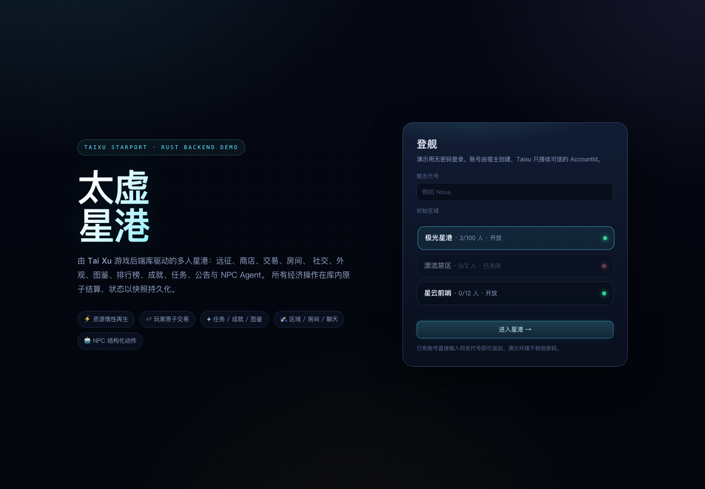
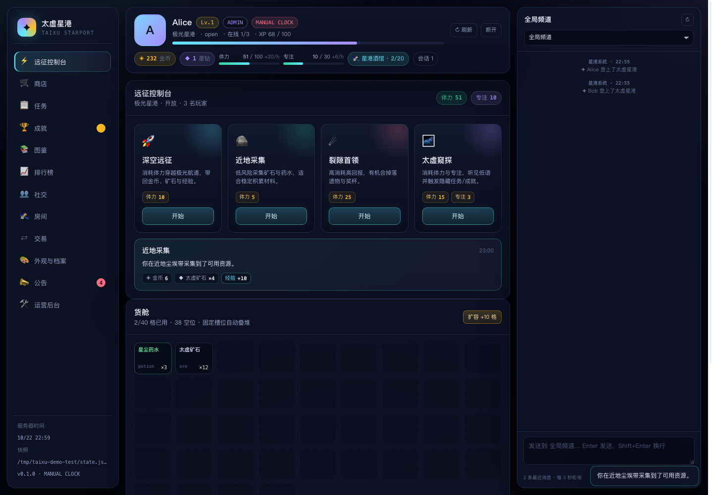
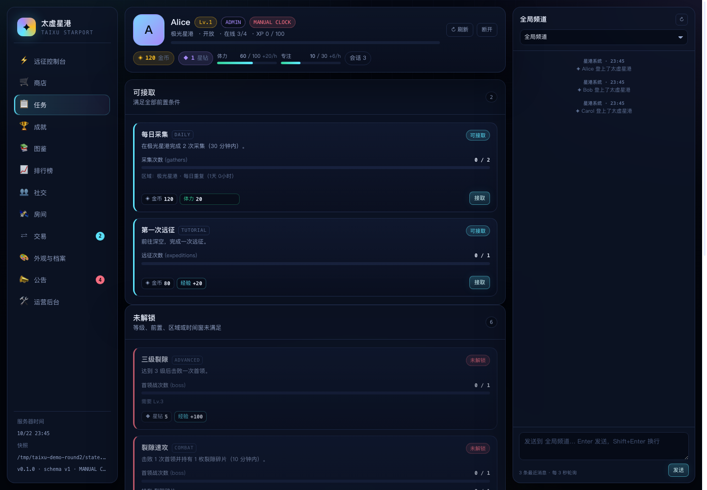
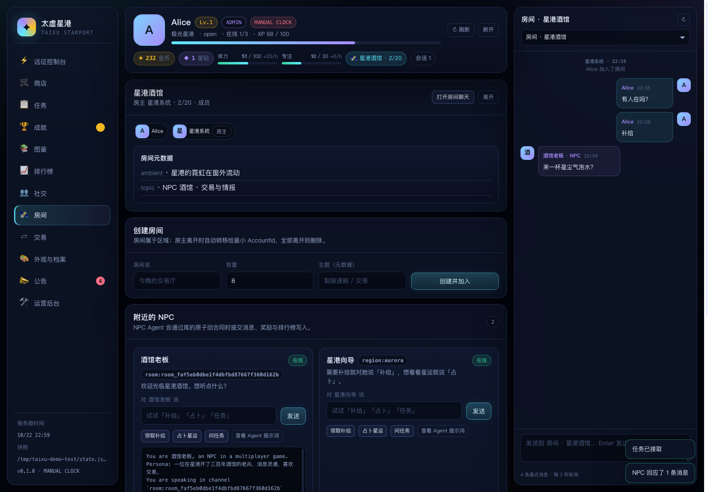
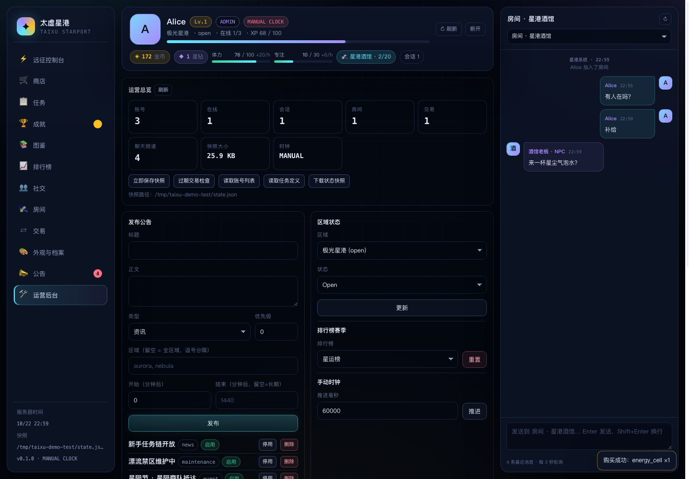

# 太虚星港 · Taixu Starport

一个由 Rust 游戏后端库 **Tai Xu**（`../taixu`）驱动的多人 Web 游戏演示，包含完整后端与前端。

> 背景：这是“游戏后端库检验员”任务的产物。目标是基于 `../taixu` 实现一个用到其全部模块/特性的 Web 游戏，并以生产级开源库的标准检验该库。两轮检验发现的问题已修复并回归（第一轮 7 项、第二轮 8 项；G5 按产品语义延期到 0.2），详见 [FINDINGS.md](FINDINGS.md) 与 [FINDINGS_ROUND2.md](FINDINGS_ROUND2.md)。



## 快速开始

```bash
cd taixu-demo
cargo run
# 打开 http://127.0.0.1:8080
```

首次启动会创建 `data/state.json` 并播种世界；之后自动加载快照。重置世界：

```bash
rm -rf data
```

### 环境变量

| 变量 | 默认值 | 说明 |
| --- | --- | --- |
| `TAIXU_ADDR` | `127.0.0.1:8080` | 监听地址 |
| `TAIXU_DATA` | `data/state.json` | 快照文件路径 |
| `TAIXU_ADMIN_TOKEN` | `taixu-admin` | 运营后台令牌（`X-Admin-Token`） |
| `TAIXU_MANUAL_CLOCK` | 未启用 | `1` 时使用 `ManualClock`，可在运营后台推进世界时间 |
| `TAIXU_DEBUG_PROMPT` | 未启用 | `1` 时把 NPC 的 `system_prompt()` 打到 stderr |

> **演示鉴权**：无密码登录，账号 ID 为 `player_<代号>`。Tai Xu 本身不含鉴权，生产环境必须由真实网关/鉴权系统签发可信 `AccountId`。不要把本 demo 的会话层直接用于生产。

## 玩法

- **远征**：消耗体力进行远征/采集/首领战/太虚窥探，获得货币、物品、经验；触发成就、任务、排行榜，并可能揭示隐藏任务/成就。
- **成长**：经验曲线由宿主定义，升级写入区域系统消息；背包可扩容，材料可合成/出售。
- **经济**：3 家商店（区域限定、时间窗、库存、限购、货币+资源定价）；玩家间交易采用双方挂单、双方确认、第二人确认时原子结算。
- **社交**：好友申请/接受/拒绝/撤回/删除/屏蔽；全局、区域、房间、私聊四种频道；房间创建/加入/踢人/元数据/房主转移/关闭。
- **外观**：9 件皮肤覆盖全部 `SkinCategory`；头像图片/头衔/头像框/徽章，库强制校验归属与分类。
- **长线**：图鉴（道具/皮肤/成就混合条目 + 里程碑）、高低分排行榜与赛季、成就（含隐藏）、任务（四类目标、前置、等级/区域/时间窗、限时、每日/每周/冷却/一次性、隐藏）、公告（五种类型、优先级、区域/时间窗、已读）。
- **NPC**：自定义 `StarportGuide`（`Say` + `GiveReward` + `SetScore`，带补给冷却）与内置 `RuleBasedNpc`；可查看任意 NPC 的 Agent 提示词。
- **区域**：极光星港、星云前哨、漂流禁区（关闭）；跨区迁移自动退出房间，校验目标区域状态与容量。



## Tai Xu 特性覆盖

| Tai Xu 模块 | 游戏中的使用 |
| --- | --- |
| `account` | 登录/登出/心跳、在线状态、等级/经验、显示名、metadata（bio）、区域归属 |
| `region` | 3 个节点、容量、Open/Maintenance/Closed 状态矩阵、玩家数、跨区迁移、区域聊天 |
| `room` | 星港酒馆 + 玩家房间、容量、加入/离开/关闭/踢人、元数据、房主自动转移 |
| `friend` | 申请（带留言）/接受/拒绝/撤回/删除、屏蔽/解除（双向阻断私聊与申请） |
| `chat` | 全局/区域/房间/私聊、有界历史、账号频道列表 `channels_for`、带 metadata 的交易邀请、系统消息、NPC 消息、运营删除/清空 |
| `item` | 7 种物品覆盖全部 `Rarity`，堆叠/唯一、槽位背包、标签 |
| `inventory` | 40 格起、自动叠堆、全有或全无批量操作（交易）、扩容、合成/出售 |
| `wallet` | 金币/星钻/星尘券 + 体力/专注（上限 + 每小时惰性再生） |
| `shop` | 3 家商店、货币+资源定价、库存、限购、店铺/商品时间窗、区域限定 |
| `trade` | 交易邀请私聊、双方挂单、双方确认、取消、后台过期、原子结算、`trades_for` newest-first |
| `cosmetics` / `Avatar` | 9 件皮肤覆盖 Character/Weapon/Avatar/Frame/Badge/Background/Emote/Other，头像框/徽章与已装备皮肤双向同步 |
| `collection` | 星港图鉴：道具 + 皮肤 + 成就共 10 条，4 个一次性里程碑 |
| `leaderboard` | 战力（越高越好、Top 50）、远征竞速（越低越好、Top 20）、星运（NPC 写入）、赛季重置 |
| `achievement` | 10 项成就，指标驱动、一次性领奖、隐藏成就；奖励覆盖货币/资源/物品/皮肤/经验 |
| `task` | 9 条任务：metric/item/skin/achievement 四类目标，前置、等级、区域、时间窗、限时、Once/Daily/Weekly/Cooldown、隐藏；`TaskView` 暴露锁定原因与新周期 |
| `announcement` | 五种公告类型、优先级、区域/时间窗、已读/未读；运营发布/启停/删除 |
| `npc` | `NpcRuntime` 异步回合、`NpcContext::system_prompt()`、`Say`/`GiveReward`/`SetScore`、规则型与自定义 Agent、原子回合 |
| `store` | `FileStore`（临时文件 + fsync + rename）持久化、`GAME_STATE_VERSION` 快照版本；测试中使用 `MemoryStore` |
| `clock` | 默认 `SystemClock`；`TAIXU_MANUAL_CLOCK=1` 时使用 `ManualClock`，运营后台可推进时间 |
| `reward` / `Cost` | 商店、任务、成就、图鉴、NPC、新手礼包共用奖励/价格包 |
| `ids` | 全部强类型 ID 贯穿 API、快照与前端 |
| `error` | `GameError` 统一映射为 HTTP JSON 错误 |





## 架构

```text
Browser SPA (vanilla JS, 3s polling)
        │  Bearer session token
        ▼
Axum HTTP layer (src/api.rs)
        │  trusted AccountId from host session
        ▼
Tai Xu Game (parking_lot RwLock, sync, runtime-agnostic)
        │
        ├── GameState snapshot ──► FileStore (atomic JSON)
        └── NpcRuntime (async agents, not serialized)

Host-side background tasks:
  • 15s  trade expiry
  • 30s  presence sweep (last_seen > 90s → logout)
  • 60s  snapshot
  • shutdown save
```

关键设计：

- **库负责游戏侧不变量**：商店购买、交易结算、任务/成就/图鉴领奖由库在单锁内原子完成。
- **宿主负责组合流程**：例如“扣体力 → 发奖励 → 记录指标”。当前库只有 NPC 回合有专用原子提交入口，因此 `AppState::action_lock` 串行化这类流程，并在发货失败时补偿资源（见 `src/gameplay.rs`）；通用事务 API 列入 0.2。
- **会话在宿主**：库不鉴权；HTTP 层把 Bearer token 解析为可信 `AccountId`，每个库调用都校验账号存在性/归属。
- **只读查询用 `with_state`**：不再外泄读锁 guard，避免同线程持 guard 调用写方法造成死锁。
- **Closed 区域**：库拒绝新房间/聊天/购买/交易/好友申请/接任务；宿主的远征/合成/出售/扩容也通过 `ensure_region_active` 保持一致。
- **快照原子替换 + 版本**：`FileStore` 先写 `.tmp`、`fsync`、再 `rename`；`GameState.version`（`GAME_STATE_VERSION`）随快照持久化，启动时拒绝不支持的版本；启动会先把所有账号标记为离线。
- **前端无构建链**：HTML/CSS/JS 通过 `include_str!` 嵌入二进制，所有用户输入经 `esc()` 转义。

## HTTP API（摘要）

- 公共：`GET /api/health`、`GET /api/world`、`POST /api/login`
- 会话：`POST /api/logout`、`POST /api/heartbeat`、`GET /api/state?channel=…`
- 玩法：`/api/action/explore`、`/api/inventory/{craft,sell,upgrade}`、`/api/travel`
- 社交/房间：`/api/rooms/*`、`/api/chat/*`、`/api/friends/*`
- 经济/交易：`/api/shop/buy`、`/api/trades/*`
- 成长：`/api/tasks/*`、`/api/achievements/claim`、`/api/collections/claim`、`/api/announcements/read`
- NPC：`/api/npc/say`、`/api/npc/prompt`
- 运营（`X-Admin-Token`）：`/api/admin/*`（总览、公告、区域状态、赛季、聊天治理、发放、容量、NPC、商品、时钟推进、过期交易、保存/快照）



## 验证

```bash
# 宿主演练 + 两轮库缺陷回归（demo_smoke 1 + library_probe 6 + second_round_probe 9）
cargo test

# 单独跑第二轮回归
cargo test --test second_round_probe -- --test-threads=1

# 严格 clippy
cargo clippy --all-targets -- -D warnings

# 前端语法
node --check web/app.js
```

- `tests/library_probe.rs`：第一轮 7 项库缺陷探针，修复后 6/6 通过（F7 为 README 编译错误，通过原文编译验证）。
- `tests/second_round_probe.rs`：第二轮 9 个回归（G1–G4、G6–G9），全部通过；G5 按 0.2 延期，无失败探针。
- `tests/demo_smoke.rs`：宿主级集成测试，覆盖播种世界、远征、商店、合成/出售、NPC 回合、公告已读、区域迁移、`MemoryStore` 快照往返与 `ManualClock` 资源再生。
- 库自身：44 项测试通过、`cargo clippy --all-targets -- -D warnings` 干净（2026-10-22，HEAD `511e5dd`）。

手动验收（已用无头 Chromium + CDP 跑过）：

1. 登录 → 远征/采集 → 背包/合成/出售/扩容
2. 商店购买（资源+货币、限购、库存）
3. 任务接取/完成/领奖、成就领奖、图鉴里程碑领奖
4. 好友申请/接受、私聊、交易邀请（带 metadata）、双方挂单/确认/结算
5. 创建房间/元数据/踢人/关闭、房间聊天、NPC 补给/占卜/提示词
6. 区域迁移（自动退房、NPC/任务随区域变化）
7. 公告已读、运营发布/发放/容量/区域状态/NPC 启停/时钟推进
8. 任务锁定原因（前置/区域/时间窗）与新周期视图
9. 非好友 DM 发现、头像框与已装备皮肤双向同步、Closed 区域只读+拒绝新活动、交易 newest-first

## 0.2 / 仍未处理的生产化建议

第一轮 7 项与第二轮 G1–G4、G6–G9 已修复并验收（见 [FINDINGS.md](FINDINGS.md)、[FINDINGS_ROUND2.md](FINDINGS_ROUND2.md)）。以下不属于 demo 阻塞项：

**已接受 0.2 设计**

1. **G5 保留策略 / 账号删除 / 限购索引**：retention 涉及审计、客服追溯、合规与存储成本；`erase_account` 需要墓碑机制和跨模块清理；购买限购索引属于持久化结构变更。0.2 范围：可配置 retention + `erase_account` 墓碑 + schema 迁移。
2. **通用宿主事务 API**：当前只有 `Game::apply_npc_turn` 有专用原子提交入口；远征/合成/出售/扩容仍由宿主 `action_lock` + 失败补偿。建议 0.2 设计 `Game::transact` 或批量操作。
3. **货币目录**：`CurrencyId` 无定义目录；demo 暂时在 `gameplay::currency_meta` 硬编码名称/图标。建议 0.2 与事务 API 同期设计。

**仍未处理**

4. **注册时不校验引用**：商店/任务/图鉴/成就/NPC 可引用不存在的 ID，错误延迟到运行时；建议 `validate_world()`。
5. **隐藏任务的发现路径**：`task_views` 会过滤无进度的隐藏任务，库内没有触发接口；demo 在“太虚窥探”时由宿主 `accept_task` 揭示。
6. **公告已读缺少可见性校验**：任意账号可凭 ID 标记不可见公告为已读。
7. **`GameStore` 是同步 trait**：网络型存储需宿主自行 `spawn_blocking`。
8. **校验策略不完全一致**：如 `Inventory::new(0)`、`with_contents` 绕过堆叠上限、房间名/聊天正文不校验控制字符。

第二轮验收：`tests/second_round_probe.rs` 9/9 通过；demo 已移除任务提示表、好友推导 DM、宿主交易排序、头像手工同步等 workaround，改用 `TaskView` 锁定字段、`channels_for`、库内 newest-first、双向同步与 `with_state`。

## 生产化边界

本 demo 刻意保持单进程、无构建链、易运行；生产部署还应补充：

- 真实鉴权/会话（OIDC、JWT、HttpOnly cookie、CSRF 策略）、HTTPS、限流与审计
- WebSocket/SSE 推送替代 3 秒轮询
- 数据库/对象存储持久化与增量落盘，替代全量 JSON 快照
- 多实例下的一致性/选主、会话外置
- 真实 LLM Agent（当前 `StarportGuide` 为规则型，但接口与 prompt 已按 LLM 集成设计）
- 完整的前端构建、可访问性与端到端测试

## 目录

```text
src/
  main.rs       启动、后台任务、优雅退出
  api.rs        Axum 路由、会话提取、状态聚合、运营接口
  state.rs      AppState、宿主会话、GameConfig
  seed.rs       世界种子（全部注册表）
  gameplay.rs   远征/合成/出售/扩容、等级曲线、频道解析
  npc_agent.rs  StarportGuide（Say/GiveReward/SetScore）
  store.rs      FileStore
  error.rs      GameError → HTTP 错误
web/
  index.html    单页外壳
  style.css     暗色星港 UI
  app.js        全部前端逻辑
tests/
  library_probe.rs  库缺陷回归探针
  demo_smoke.rs     宿主级集成测试
docs/             无头浏览器验收截图
```
